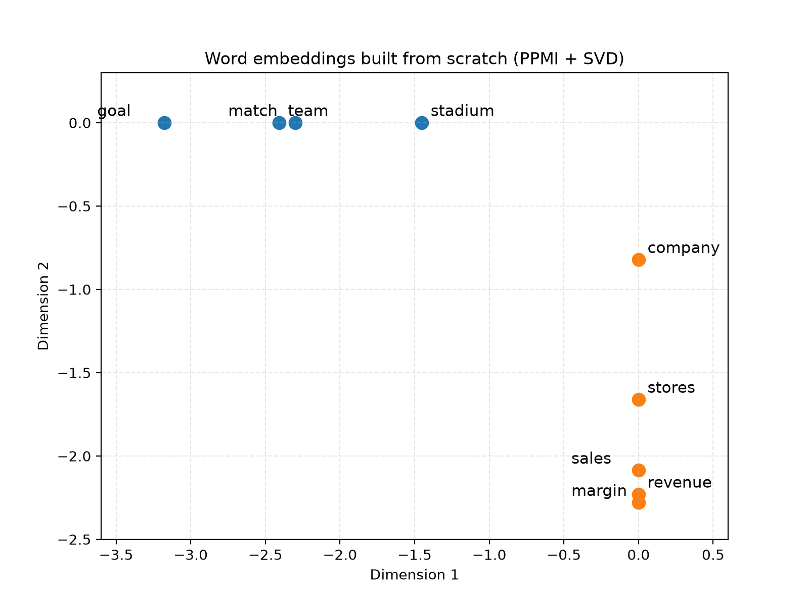

# The Making of RAG: Embedding (Part 3)

## Introduction

This is the third article in my *Making of RAG* series, and we have finally arrived at the step where we actually start
building something meaningful: **embedding**.

In the previous two articles, I covered the preparation: [chunking](https://medium.com/@fmoudoute/chunking-the-making-of-rag-part-1-d273260d1c9c)
and [tokenization](https://medium.com/@fmoudoute/tokenization-the-making-of-rag-part-2-cea980ba5e03), getting our text
ready. But preparation alone doesn't build anything. We can have the finest ingredients in the world, chopped perfectly,
but if we don't cook them, we won't have a meal (yes... building, cooking... I know, I keep mixing my metaphors :).

If tokenization is the raw material (the bricks and the steel) and chunking is the foundation of the building, then
embeddings are the **blueprint**. They are the mathematical representation that defines the location, the relationships,
and the structure of every building block.

In this article, I am going to pull back the curtain in two steps. First, we will build word embeddings **from scratch**,
with nothing but `numpy` and a bit of math (**co-occurrence counts**, **PPMI**, **SVD** and **cosine similarity**), so we
can see exactly where those mysterious floats come from. Then, we will plug in a real, pre-trained embedding model and use it on
the same Luckin Coffee earnings transcript I used in the tokenization article. We will see where it shines, and also where it
quietly fails because of the choices we made in Part 1 and Part 2.

Every output in this article comes from code that I ran myself. The full scripts are at the end, so you can run them too.

*(As always, if you find this helpful, a thumbs-up helps others find it and keeps me writing!)*

---

## Embedding, or the geometry of meaning

At its most basic level, an embedding is just a **dense vector**: a list of floating-point numbers that captures the
meaning of a piece of text (a word, a sentence, or a whole chunk).

What makes embeddings special is how they organize themselves in space: texts with similar meanings land close together,
and unrelated texts land far apart. Once meaning becomes a position in space, "find me something relevant" becomes
"find me the nearest points", which a computer does very well.

But here is the thing that drives people crazy: **where do these floats actually come from?** Nobody manually decided
that "revenue" gets a 0.69 in dimension 4. The answer goes back to a 1957 idea from the linguist J.R. Firth that I
really like:

> *"You shall know a word by the company it keeps."*

This is the **distributional hypothesis**: words that appear in similar contexts tend to have similar meanings. "Sales"
and "revenue" are surrounded by the same neighbours ("grew", "quarter", "increased"...), so they must be related, even
if they never appear in the same sentence. Every embedding method, from the 1990s count-based methods to today's
transformer models, is a more or less sophisticated way of turning that idea into numbers.

For a RAG system, embeddings are the engine of **semantic search**. Keyword search only finds exact matches. Semantic
search understands that "How did sales grow?" and "Revenue increased this quarter" talk about the same thing, because
their embeddings are close in space.

Just like chunking and tokenization, embedding has a direct impact on the quality of a RAG pipeline. I will use the
same angles as in the previous articles:

### 1 - Accuracy

The embedding is the *only* thing the retriever looks at. If two texts that mean the same thing end up far apart, or if
two unrelated texts end up close, the retriever will bring back the wrong chunk, and the LLM will answer confidently from
the wrong context. No prompt engineering at the generation step can fix a chunk that was never retrieved. We will
see a concrete example of this with a Chinese query below.

### 2 - Cost

Every chunk is stored as a vector, and every vector costs memory, storage, and compute at search time. A model producing
3,072 floats per chunk costs 8 times more to store and to scan than a model producing 384 floats. Over millions of
chunks, that is a real line on the cloud bill (I'll put numbers on it below).

### 3 - Context Preservation

An embedding model can only "see" a limited number of tokens. Anything beyond that limit is silently cut off: no error,
no warning. This is exactly where chunk size (Part 1) and tokenization (Part 2) come back to bite us, and I will
show you a chunk from the Luckin transcript where it happens.

---

## Where embedding fits in the pipeline

As a reminder from Part 2, here is the typical RAG flow:

* **Document Ingestion**: Raw text enters the system
* **Tokenization**: Text is converted to tokens (Part 2)
* **Chunking**: Tokens are grouped into chunks (Part 1)
* **Embedding**: Each chunk is converted to a vector (the focus of this article)
* **Indexing**: Vectors are stored in a vector database
* **Retrieval**: User queries are tokenized, embedded, and matched against stored vectors
* **Generation**: Retrieved context is fed to a language model for response generation

Notice that, just like tokenization, embedding happens **twice**: once for every chunk at ingestion time, and once for
every user query at search time. And both **must** use the same model. A vector from model A and a vector from model B
live in two different spaces; comparing them is like comparing a GPS coordinate with a street address.

---

## Building embeddings from scratch

Let me be honest: you will never build your production embeddings this way. But I have found that doing it once by
hand removes all the "magic" around embeddings, and it makes everything that comes after much easier to understand.

We will follow four mathematical steps:

1. **Co-occurrence matrix (X):** count which words appear next to which.
2. **PPMI (Positive Pointwise Mutual Information):** turn raw counts into "how surprising is this pairing".
3. **SVD (Singular Value Decomposition):** compress each word into a short, dense vector.
4. **Cosine similarity:** measure how close two vectors are.

Our "training corpus" is deliberately tiny: a few finance sentences and a few football sentences. Note one important
detail: **"sales" and "revenue" never appear in the same sentence.** If our embeddings still put them close together,
it means the math really learned something from their *contexts*.

### Step 1: The co-occurrence matrix

For each word, we count the words that appear within 2 positions of it (the "window"). We also drop very common words
("the", "a", "in"...), the same way some tokenizers did in Part 2, because they appear everywhere and carry little meaning.

```python
import numpy as np

# The raw text (our tiny "training corpus")
corpus = [
    "Revenue grew strongly in the first quarter",
    "Sales grew strongly across our new stores",
    "Quarterly revenue increased thanks to new stores",
    "Sales increased in the first quarter",
    "The company reported higher revenue and a better margin",
    "The company reported higher sales and a better margin",
    "Operating margin improved during the quarter",
    "The team scored a late goal in the match",
    "The players scored a goal in the final",
    "The striker scored twice during the match",
    "The team won the final after a late goal",
    "Fans celebrated the goal in the stadium",
]
STOP_WORDS = {"the", "a", "in", "and", "to", "our", "after", "during", "across", "thanks"}


def tokenize(text):
    words = text.lower().replace("?", "").replace(",", "").split()
    return [w for w in words if w not in STOP_WORDS]


sentences = [tokenize(s) for s in corpus]
vocab = sorted({w for s in sentences for w in s})
word_to_id = {w: i for i, w in enumerate(vocab)}

WINDOW = 2
X = np.zeros((len(vocab), len(vocab)))
for s in sentences:
    for i, word in enumerate(s):
        for j in range(max(0, i - WINDOW), min(len(s), i + WINDOW + 1)):
            if i != j:
                X[word_to_id[word], word_to_id[s[j]]] += 1

print(f"Co-occurrence matrix shape: {X.shape}")
print(f"'sales' and 'revenue' appear together {int(X[word_to_id['sales'], word_to_id['revenue']])} times")
```

#### After:

```text
Co-occurrence matrix shape: (30, 30)
'sales' and 'revenue' appear together 0 times
```

Our vocabulary has 30 words, so each word is described by a row of 30 counts. Keep in mind that number: with a real
corpus, the vocabulary is hundreds of thousands of words, and this matrix becomes huge and almost entirely made of zeros.

### Step 2: PPMI

Raw counts are misleading. A word like "quarter" appears next to many words simply because it is frequent, not because
it is strongly related to each of them. PMI corrects for that by comparing how often two words appear together with how
often we would expect them to appear together *by chance*:

`PMI(word, context) = log( P(word, context) / (P(word) × P(context)) )`

A positive value means "these two appear together more than chance". A negative value is usually noise on a small corpus,
so we clip it to zero: that's the **P**ositive in PPMI.

```python
def compute_ppmi(matrix):
    total = matrix.sum()
    p_word = matrix.sum(axis=1, keepdims=True) / total
    p_context = matrix.sum(axis=0, keepdims=True) / total
    p_joint = matrix / total
    with np.errstate(divide="ignore"):
        pmi = np.log(p_joint / (p_word * p_context))
    return np.maximum(pmi, 0)  # log(0) = -inf -> clipped to 0


X_ppmi = compute_ppmi(X)
```

A small note for the curious: this is not just an "old school" trick. Levy and Goldberg showed in 2014 that Word2Vec,
one of the most famous neural embedding methods, is implicitly factorizing a (shifted) PMI matrix. So the neural network
and our counting approach are much closer relatives than they look.

### Step 3: SVD, from 30 sparse counts to 5 dense floats

Here is where the dense vectors are born. SVD decomposes our PPMI matrix into directions ordered by how much of the
structure of the data they explain. By keeping only the first K directions, we compress each word into K floats while
keeping the most important patterns. I'm using `numpy`'s SVD here; you could also implement it by hand with power
iteration, but numpy's version is exact and gives the same result every time you run it.

```python
K = 5
U, S, Vt = np.linalg.svd(X_ppmi)
word_vectors = U[:, :K] * S[:K]

for w in ["revenue", "sales", "goal"]:
    print(f"{w:8} -> {np.round(word_vectors[word_to_id[w]], 2) + 0.0}")
```

#### After:

```text
revenue  -> [ 0.   -2.23  0.    0.69  0.62]
sales    -> [ 0.   -2.09  0.    0.21  0.75]
goal     -> [-3.18  0.   -1.82  0.    0.  ]
```

**This is it. These are embeddings.** Look at them for a second: "revenue" and "sales" have almost the same numbers,
while "goal" lives in completely different dimensions. Nobody told the algorithm that dimension 1 is about football and
dimension 2 is about finance; it found those directions on its own, just from the counts.



When we plot the first two dimensions, the two topics separate cleanly: the football words line up along one axis and
the finance words along the other.

### Step 4: Cosine similarity

To measure how close two vectors are, we use the cosine of the angle between them:
`cos(θ) = (A · B) / (||A|| × ||B||)`. A value of 1 means "same direction", 0 means "unrelated", and -1 means "opposite".
We care about the *direction* rather than the length, because the length mostly reflects how frequent a word is.

```python
def cosine_similarity(a, b):
    return np.dot(a, b) / (np.linalg.norm(a) * np.linalg.norm(b))


def nearest(word, n=3):
    v = word_vectors[word_to_id[word]]
    scores = [(cosine_similarity(v, word_vectors[i]), w) for i, w in enumerate(vocab) if w != word]
    return sorted(scores, reverse=True)[:n]


for w in ["sales", "goal", "margin"]:
    print(f"{w:8} -> " + ", ".join(f"{o} ({s:.2f})" for s, o in nearest(w)))

print(f"sales vs revenue: {cosine_similarity(word_vectors[word_to_id['sales']], word_vectors[word_to_id['revenue']]):.2f}")
print(f"sales vs goal   : {cosine_similarity(word_vectors[word_to_id['sales']], word_vectors[word_to_id['goal']]):.2f}")
```

#### After:

```text
sales    -> revenue (0.98), better (0.86), quarterly (0.84)
goal     -> players (0.93), stadium (0.87), fans (0.87)
margin   -> improved (0.96), operating (0.96), quarter (0.84)
sales vs revenue: 0.98
sales vs goal   : 0.00
```

"Sales" and "revenue" never met in the corpus, yet their similarity is 0.98, because they keep the same company. "Sales" and
"goal" share no context at all, and their similarity is exactly 0. That's the distributional hypothesis, in numbers.

---

## From word embeddings to semantic search

A RAG system doesn't search for words, it searches for **chunks**. The simplest way to turn word vectors into a chunk
vector is to average the vectors of all the words in the chunk. Let's build a tiny knowledge base and ask a question
that shares **no word at all** with the right answer:

```python
def embed_text(text):
    ids = [word_to_id[w] for w in tokenize(text) if w in word_to_id]
    if not ids:
        return np.zeros(K)  # every word is out-of-vocabulary
    return word_vectors[ids].mean(axis=0)


knowledge_base = [
    "Revenue grew strongly in the first quarter",
    "Operating margin improved during the quarter",
    "The team won the final after a late goal",
    "Fans celebrated the goal in the stadium",
]
query = "How did sales evolve?"
q_vec = embed_text(query)
print(f"Query = '{query}'")
print(f"words the model knows: {[w for w in tokenize(query) if w in word_to_id]}")
for doc in knowledge_base:
    keyword_hits = len(set(tokenize(query)) & set(tokenize(doc)))
    print(f"keyword={keyword_hits}  cosine={cosine_similarity(q_vec, embed_text(doc)):+.2f}  -> {doc}")
```

#### After:

```text
Query = 'How did sales evolve?'
words the model knows: ['sales']
keyword=0  cosine=+0.84  -> Revenue grew strongly in the first quarter
keyword=0  cosine=+0.48  -> Operating margin improved during the quarter
keyword=0  cosine=+0.00  -> The team won the final after a late goal
keyword=0  cosine=+0.00  -> Fans celebrated the goal in the stadium
```

Keyword search scores zero everywhere: it has nothing to work with. Semantic search, on the other hand, ranks the revenue
sentence first. **That is semantic search, end to end, in less than 100 lines of numpy.**

But look carefully at the second line of the output, because it shows the limits of our home-made model:

* **Out-of-vocabulary words are simply ignored.** "How", "did" and "evolve" are not in our 30-word vocabulary, so the
  query was reduced to the single word "sales". This is the exact word-level tokenization problem we discussed in Part 2.
* **Word order is lost.** Averaging means "the team beat the company" and "the company beat the team" get the same vector.
* **One word, one vector.** "Bank" in "river bank" and "bank account" would get the same embedding.

Modern embedding models were built precisely to solve these three problems.

---

## From toy to production: a pre-trained embedding model

A modern embedding model is still doing what we just did: turning text into a vector so that similar meanings are close.
But instead of counting co-occurrences in 12 sentences, a neural network (a transformer) has learned its parameters from
a huge number of sentence pairs (more than a billion for `all-MiniLM-L6-v2`, according to its model card). And instead of one fixed vector per word, it produces a vector for every **token in
context**.

Under the hood, an embedding model is really three pieces:

1. **A tokenizer**: our old friend from Part 2. It turns the text into token IDs.
2. **A neural network**: it returns one vector *per token*, each one influenced by all the other tokens around it.
3. **Pooling**: we average the token vectors into a single vector for the whole text (exactly like our `embed_text`
   above!), then normalize it to length 1.

Most tutorials hide these three pieces behind a one-liner like `model.encode(texts)` from the `sentence-transformers`
library. I wanted to keep the curtain open, so the code below loads the popular `all-MiniLM-L6-v2` model (384 dimensions)
with `onnxruntime` and does the tokenization and pooling by hand. It runs the same steps that `model.encode()` runs
for this model (tokenize, transformer, mean pooling, normalize), but here you can actually see every one of them.

```python
# pip install numpy onnxruntime tokenizers huggingface_hub
import numpy as np
import onnxruntime as ort
from huggingface_hub import hf_hub_download
from tokenizers import Tokenizer


class EmbeddingModel:
    def __init__(self, model_id, max_tokens):
        self.tokenizer = Tokenizer.from_file(hf_hub_download(model_id, "tokenizer.json"))
        self.tokenizer.enable_truncation(max_length=max_tokens)
        self.tokenizer.enable_padding()
        self.session = ort.InferenceSession(hf_hub_download(model_id, "onnx/model.onnx"))

    def embed(self, texts):
        # 1. Tokenize (Part 2 of the series!)
        encodings = self.tokenizer.encode_batch(texts)
        input_ids = np.array([e.ids for e in encodings], dtype=np.int64)
        attention_mask = np.array([e.attention_mask for e in encodings], dtype=np.int64)

        # 2. The network returns one vector PER TOKEN: shape (texts, tokens, dims)
        token_vectors = self.session.run(None, {
            "input_ids": input_ids,
            "attention_mask": attention_mask,
            "token_type_ids": np.zeros_like(input_ids),
        })[0]

        # 3. Mean pooling: average the token vectors (ignoring padding) -> one vector per text
        mask = attention_mask[..., None]
        vectors = (token_vectors * mask).sum(axis=1) / mask.sum(axis=1)

        # L2-normalize, so cosine similarity becomes a simple dot product
        return vectors / np.linalg.norm(vectors, axis=1, keepdims=True)
```

Now let's chunk the Luckin Coffee Q1 2026 earnings transcript with the fixed-size chunking from Part 1 (120 words per
chunk, with 20 words of overlap), embed every chunk, and compare keyword search with semantic search:

```python
def fixed_size_chunk(text, chunk_size=120, overlap=20):
    words = text.split()
    step = chunk_size - overlap
    return [" ".join(words[i:i + chunk_size]) for i in range(0, len(words), step)]


with open("files/luckin_coffee_transcript_cleaned.txt", encoding="utf-8") as f:
    chunks = fixed_size_chunk(f.read())


def keyword_search(query):
    q_words = set(query.lower().replace("?", "").split())
    overlaps = [q_words & set(c.lower().split()) for c in chunks]
    best = int(np.argmax([len(o) for o in overlaps]))
    return best, sorted(overlaps[best])


def semantic_search(model, chunk_vectors, query):
    scores = chunk_vectors @ model.embed([query])[0]  # cosine similarity
    best = int(np.argmax(scores))
    return best, scores[best]


english = EmbeddingModel("sentence-transformers/all-MiniLM-L6-v2", max_tokens=256)
chunk_vectors = english.embed(chunks)
print(f"{len(chunks)} chunks -> embedding matrix of shape {chunk_vectors.shape}")
```

I deliberately chose questions that a real user would ask, using words that are **not** the ones management used on
the call ("shops" instead of "stores", "abroad" instead of "overseas"):

#### After:

```text
38 chunks -> embedding matrix of shape (38, 384)

QUERY: How many shops does the company operate?
  keyword  -> chunk 28, matched on ['how', 'the']
  semantic -> chunk  7, cosine 0.48: ...p. By the end of the first quarter, our total store count reached 33,596, representing 39% year-over-year grow...

QUERY: Is the company expanding abroad?
  keyword  -> chunk 33, matched on ['company', 'is', 'the']
  semantic -> chunk 10, cosine 0.50: ...re-level performance, and build further overseas operating experience and customer insights, while prudently e...

QUERY: Where does the company source its coffee?
  keyword  -> chunk 33, matched on ['coffee', 'company', 'the']
  semantic -> chunk 15, cosine 0.55: ...g over 30,000 tons of coffee beans from Yunnan. This not only strengthens the diversity and resilience of our ...
```

Keyword search picks its chunks only because they contain "the", "how" or "company". Twice it lands on chunk 33, an
analyst asking about the share repurchase program. On the first query it lands on chunk 28, an analyst asking about the
pace of store openings. That one is close to the topic, but only by luck: it was picked for "how" and "the", and it
doesn't contain the store count. Semantic search finds the right chunk all three times: the
store count, the overseas expansion, and the Yunnan coffee beans. It knows that "shops" means "stores" and that "abroad"
means "overseas", and nobody wrote a synonym list.

Also notice the scores: 0.48, 0.50, 0.55. These are the *best* matches, and they are far from 1.0. That is normal: a
short question and a 120-word chunk are never "the same text". This is why using a fixed threshold like "only keep
results above 0.8" is a bad idea, and why we rank results instead.

---

## When the tokenizer bites back

The Luckin transcript is bilingual: the CEO's remarks are given in Chinese, followed by the English translation. So a
Chinese-speaking analyst could reasonably ask: **"公司有多少家门店？"** ("How many stores does the company have?").
Let's ask both an English model and a multilingual model, and look at what their tokenizers see:

```python
multilingual = EmbeddingModel("sentence-transformers/paraphrase-multilingual-MiniLM-L12-v2", max_tokens=128)
query = "公司有多少家门店？"
for name, model in [("all-MiniLM-L6-v2", english),
                    ("paraphrase-multilingual-MiniLM-L12-v2", multilingual)]:
    tokens = model.tokenizer.encode(query).tokens
    best, score = semantic_search(model, model.embed(chunks), query)
    print(name)
    print(f"  tokens -> {tokens}")
    print(f"  best   -> chunk {best:2}, cosine {score:.2f}: {chunks[best][:70]}...")
```

#### After:

```text
all-MiniLM-L6-v2
  tokens -> ['[CLS]', '公', '司', '有', '[UNK]', '[UNK]', '家', '[UNK]', '[UNK]', '？', '[SEP]']
  best   -> chunk 18, cosine 0.43: engagement, and customer experience to further unlock consumption pote...
paraphrase-multilingual-MiniLM-L12-v2
  tokens -> ['<s>', '▁公司', '有多少', '家', '门', '店', '?', '</s>']
  best   -> chunk  7, cosine 0.48: a clear focus on healthy store-level performance. We further deepened ...
```

This is my favourite result of the whole article, because it ties Part 2 and Part 3 together. The English model's
WordPiece tokenizer doesn't know the characters for "how many" (多少) or for "store" (门店): they become `[UNK]`, the
unknown token. **The model never even saw the most important words of the question**, so it returned a chunk that has nothing to do with stores, still with a
reasonable-looking score of 0.43. Nothing crashed and nothing warned us; the answer was just wrong.

The multilingual model uses a SentencePiece tokenizer (notice the `▁` meta-symbol we discussed in Part 2), keeps every
character, and goes straight to chunk 7: "our total store count reached 33,596".

---

## When the chunk is too long: silent truncation

Every embedding model has a maximum number of tokens it reads. For `all-MiniLM-L6-v2`, it's 256 tokens. Our chunks are
120 *words*, so we should be fine... right?

```python
chunk = chunks[7]
english.tokenizer.no_truncation()
print(f"Chunk 7: {len(chunk.split())} words -> {len(english.tokenizer.encode(chunk).ids)} tokens (limit: 256)")
english.tokenizer.enable_truncation(max_length=256)

original = english.embed([chunk])[0]
off_topic = "The striker scored a late goal and the fans celebrated in the stadium."
appended = english.embed([chunk + " " + off_topic])[0]
prepended = english.embed([off_topic + " " + chunk])[0]
print(f"cosine(chunk, chunk + football sentence) = {original @ appended:.4f}")
print(f"cosine(chunk, football sentence + chunk) = {original @ prepended:.4f}")
```

#### After:

```text
Chunk 7: 120 words -> 307 tokens (limit: 256)
cosine(chunk, chunk + football sentence) = 1.0000
cosine(chunk, football sentence + chunk) = 0.8634
```

Chunk 7 contains a Chinese paragraph, and since the tokenizer splits Chinese into one token per character, 120 "words" became
307 tokens. Everything after token 256 is thrown away before the model even starts. The proof: I appended a football sentence at
the end of the chunk, and the embedding didn't change at all (**cosine = 1.0000**). The model never saw it. When I put the
same sentence at the beginning, the embedding moved (0.8634).

Now imagine that the cut-off part of your chunk is the paragraph containing the answer. It will never be retrieved, and
you will never get an error message. This is why I insisted in Part 1 and Part 2 that **chunk size must be measured in
the tokens of your embedding model**, not in words or characters.

---

## Choosing an embedding model (Practical)

Now that you understand the mechanics, choosing a model in production becomes a matter of trade-offs. Here are the
questions I ask myself, in this order:

**Step 1: Consider your languages.** As we just saw, an English-only model can be completely blind to another language,
and it fails silently. If your documents or your users are multilingual, use a multilingual model, and test it with real
queries in each language.

**Step 2: Consider your domain.** Are you embedding legal texts, medical notes, or earnings calls? Generic models may
miss specialized vocabulary or acronyms. Build a small test set of 20-50 real questions with their expected chunks
(like the three queries above) and measure how often the right chunk comes back in the top results. That small test
set is worth more than any leaderboard.

**Step 3: Consider the maximum input length.** Check the token limit of the model (256 for `all-MiniLM-L6-v2`, 128 for
`paraphrase-multilingual-MiniLM-L12-v2`, several thousands for most commercial API models) and set your chunk size
*below* it, measured with the model's own tokenizer.

**Step 4: Consider dimensionality and cost.** More dimensions can capture more nuance, but every float costs memory.
With float32 (4 bytes per number), here is what storing **1 million chunks** costs before any index overhead:

| Dimensions | Example model                    | Storage for 1M chunks |
|-----------:|----------------------------------|----------------------:|
|        384 | `all-MiniLM-L6-v2`               |               1.54 GB |
|        768 | many BERT-base models            |               3.07 GB |
|      1,536 | `text-embedding-3-small`         |               6.14 GB |
|      3,072 | `text-embedding-3-large`         |              12.29 GB |

The formula is simply `chunks × dimensions × 4 bytes`. And since most vector databases keep the index in memory for fast
search, this goes directly into the size (and the price) of your machines.

---

## Production Considerations

1. **Pre-compute your chunk embeddings.** Embed every chunk once, at ingestion time, and store the vectors in your
   vector database. At query time, only the user's question needs to be embedded, which is a single, fast call.
2. **Same model for documents and queries, always.** If you upgrade your embedding model, you must re-embed your whole
   corpus. Vectors from two different models are not comparable, even if they have the same number of dimensions.
3. **Normalize your vectors.** Once vectors have length 1, cosine similarity becomes a simple dot product (that's what
   `chunk_vectors @ query_vector` does above), which is faster and is what most vector databases expect.
4. **Watch for silent failures.** As we saw, `[UNK]` tokens and truncation never raise errors. Log the token count of
   every chunk at ingestion, and check how many `[UNK]` tokens appear in your corpus and in your users' queries.
5. **Handle drift.** Language and content change over time (new products, new acronyms). Keep your small test set and
   re-run it regularly to make sure retrieval quality doesn't quietly degrade.
6. **Use a vector database at scale.** For 38 chunks, a numpy dot product is perfect. For millions, tools like Qdrant,
   Pinecone, Milvus or pgvector use approximate nearest-neighbour indexes to do this math in milliseconds.

---

## Conclusion

Embeddings are the bridge between raw text and machine reasoning. What I find fascinating is that the floats are not
hand-crafted at all: whether they come from 12 sentences and an SVD, or from a transformer trained on a billion
sentence pairs, they come from the same idea: *you shall know a word by the company it keeps*.

But this article also showed that the embedding step inherits every decision made before it. A tokenizer that doesn't
know your language turns your question into `[UNK]`. A chunk that is too long is silently truncated. That's why I
think chunking, tokenization and embedding should never be designed separately: they are the foundation, the materials
and the blueprint of the same building.

In the next article, I'll cover **retrieval**: how we actually search these vectors at scale, why the top result is not
always the best one, and how to combine semantic and keyword search to get the best of both worlds.

If you've found this series helpful, I'd really appreciate a follow. It helps me know that people are reading and
encourages me to keep writing.

---

## Run it yourself

Both scripts are in the `scripts/` folder of my project and should be run from that folder:

* `embedding_from_scratch.py`: requires only `numpy` and `matplotlib`.
* `embedding_pretrained.py`: requires `pip install numpy onnxruntime tokenizers huggingface_hub`. The models
  (about 90 MB for the English one, about 470 MB for the multilingual one) are downloaded automatically from
  Hugging Face on the first run.

## References
- J.R. Firth (1957), *A Synopsis of Linguistic Theory, 1930–1955*: "You shall know a word by the company it keeps"
- O. Levy & Y. Goldberg (2014), [Neural Word Embedding as Implicit Matrix Factorization](https://papers.nips.cc/paper/2014/hash/feab05aa91085b7a8012516bc3533958-Abstract.html)
- [all-MiniLM-L6-v2 model card](https://huggingface.co/sentence-transformers/all-MiniLM-L6-v2)
- [paraphrase-multilingual-MiniLM-L12-v2 model card](https://huggingface.co/sentence-transformers/paraphrase-multilingual-MiniLM-L12-v2)
- [Sentence Transformers Documentation](https://www.sbert.net/)
- [MTEB Leaderboard](https://huggingface.co/spaces/mteb/leaderboard)
